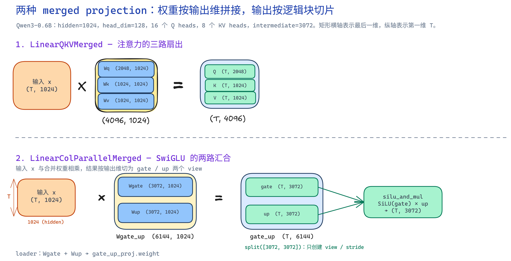
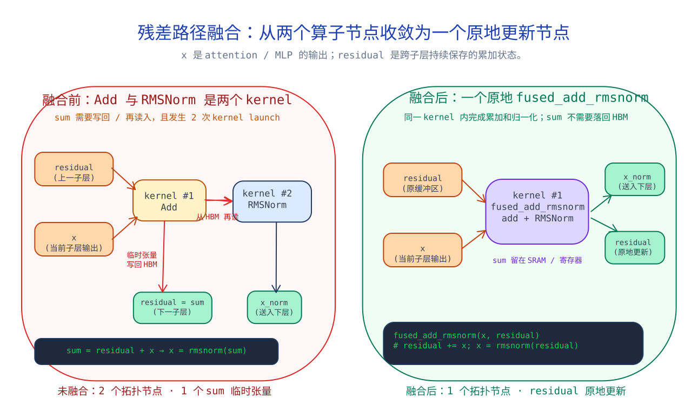

# 算子融合

# 背景

在LLM推理过程中，Decode阶段偏向内存密集型，GPU 计算单元利用率降低，而 CPU 到 GPU 的 Kernel Launch 延迟、Tensor 在 HBM 和 Cache 之间的数据搬运成本占比会上升。

针对Decode阶段，需要做的优化有：1. 减少Kernel数量，例如把QKV Projection合并成Packed GEMM，把Gate Projection和Up Projection合并；2. 减少中间Tensor的HBM往返，融合Add + RMSNorm、SwiGLU等Element-wise算子

# Kernel Fusion的重要性

Prefill：需要一次性处理整个输入，其中有着大量的GEMM，GPU很容易吃满

Decode：每次只生成一个Token，这个时候Memory Access增大，更偏向于Memory Bound，需要通过KV Cache、Batching、Kernel Fusion、CUDA Graph 降低调度和访存成本。



# QKV Linear Merged

## 1. 原始实现

Transformer Attention：

输入：

$$
X
$$

三个 Linear：

$$
Q=XW_Q\\
K=XW_K\\
V=XW_V
$$

代码类似：

```
q = linear(x, Wq)
k = linear(x, Wk)
v = linear(x, Wv)
```

GPU：

```
Kernel1:
X × Wq

Kernel2:
X × Wk

Kernel3:
X × Wv
```

三个 GEMM。


都要经过以下三个步骤

```
Load X

Compute

Store result
```

## 2. Packed GEMM
Packed GEMM（Merged Linear）核心就是一个简单的线性代数等价关系：多个线性层共享同一个输入X，就不用分开进行GEMM了，直接拼在一起，执行一次GEMM

$$
W_{QKV}=[W_Q,W_K,W_V]
$$

于是：

$$
XW_{QKV}
$$

展开：

$$
X[W_Q,W_K,W_V]
$$

等价：

$$
[XW_Q,XW_K,XW_V]
$$

所以：

一次 GEMM：

```
        Wq
X ×     Wk
        Wv
```

输出：

```
[Q | K | V]
```

然后：

```
split
```

得到：

```
Q

K

V
```
实现的代码如下：
```python
y1 = x @ W1.T
y2 = x @ W2.T
y3 = x @ W3.T

#等价于
y_merged = x @ concat(W1, W2, W3).T
y1, y2, y3 = split(y_merged)
```

## 3. 为什么更快？

### (1) Kernel Launch减少

原：

```
Launch Q GEMM
Launch K GEMM
Launch V GEMM
```

变：

```
Launch QKV GEMM
```

减少 CPU/GPU 调度。

### (2) 输入 X 读取减少

原：

```
GEMM Q:

read X

GEMM K:

read X

GEMM V:

read X
```

变：

```
GEMM QKV:

read X once
```

减少 HBM bandwidth。

### (3) 大 GEMM GPU 利用率更高

GPU 喜欢：

```
large matrix
```

因为：

- 更多 Thread Block
- 更高 Occupancy
- Tensor Core 利用率更高

Decode：

小 Batch：

```
8×4096
```

三个小 GEMM：

GPU 很难吃满。

合并：

```
8×12288
```
计算规模扩大。

# QKV Fusion 算不算真正 Kernel Fusion？

> 严格来说 QKV Packed GEMM 更准确叫 GEMM Fusion 或 Weight Packing，它不是传统意义上把多个不同计算阶段融合到一个 CUDA Kernel 中。它利用矩阵乘法线性性质，把三个独立 GEMM 合并为一个更大的 GEMM。
> 

然后补充：

> 真正典型 Kernel Fusion 是 Add+RMSNorm、SwiGLU 这种 Element-wise 融合，因为原本存在多个 Kernel 和中间 Tensor 写回。
> 

# Gate/Up Projection Fusion

MLP中SwiGLU的公式：
$$
FFN(x)=W_2(SiLU(W_gx)\odot W_upx)
$$

## 传统计算

Gate：

$$
gate=xW_g
$$

Up：

$$
up=xW_u
$$

两个 Linear：

```
Kernel1:

x × Wg

Kernel2:

x × Wu
```

融合拼接：

$$
W_{gate,up}=[W_g,W_u]
$$

一次：

$$
xW_{gate,up}
$$

输出：

```
[g | u]
```

然后：

```
gate, up = split(output)y = silu(gate) * up
```

为什么有效？

和 QKV 一样：

- 一个输入 Load
- 一个 GEMM
- 更大的矩阵
- 更少 Kernel

# 六、Fused Add + RMSNorm

这个是最典型的 CUDA Kernel Fusion。

## 原始：

Transformer Block：
Residual:

$$
x=x+r
$$

然后：

RMSNorm:

$$
y_i=\frac{x_i}{\sqrt{\frac1n\sum x_i^2+\epsilon}}\gamma_i
$$

执行：

```
Kernel1:

Add

write HBM

Kernel2:

RMSNorm

read HBM
```

中间：

```
x+r
```

被写入显存。

融合：

一个 Kernel：

```
load x

load residual

x+r

reduce sum(x*x)

rsqrt

scale

store y
```

中间：

```
x+r
```

一直存在：

```
register/shared memory
```

不用回 HBM。

面试回答：

> Add+RMSNorm 融合的主要收益不是减少 FLOPs，而是减少一次中间 Tensor 的 HBM Round Trip。对于 Decode 阶段，小 Batch 下算术强度低，减少 Memory Traffic 比降低计算量更重要。
> 

# 七、Fused SwiGLU

原始：

$$
y=SiLU(xW_g)\times(xW_u)
$$

执行：

```
GEMM gate

store gate

GEMM up

store up

SiLU

multiply
```

多个 Kernel。

融合：

```
load gate

load up

SiLU(gate)

multiply

store
```

减少：

```
gate Tensor

up Tensor

HBM write/read
```

面试问题：

## 为什么 SwiGLU 可以融合？

回答：

因为：

- SiLU 是 element-wise
- Multiply 是 element-wise
- 不存在跨 Token 依赖

所以：

每个 thread 可以独立完成：

```
input

↓

activation

↓

multiply

↓

output
```

天然适合 GPU 并行。

# Add + RMSNorm合并


融合前，Add 的输出`sum = residual + x`同时有两条依赖边：一条把 sum 保存为下一子层的 residual，另一条把它作为 RMSNorm 的输入。两条算子节点之间需要将 sum 写回 HBM，再由下一次 kernel 读入。

融合后，`fused_add_rmsnorm(x, residual)` 保留完全相同的两条输出边：residual 在原缓冲区原地更新，归一化结果写入 x 并送给 attention / MLP。拓扑从两个 GPU 节点收敛为一个节点，sum 仅在 SRAM / 寄存器中短暂存在。

KV 写入保持在 MHAKVCache.store_kv()，但其实现委托给 kernel.store_cache()。输入是新 token 的 (k, v, out_loc)，内核按 out_loc 将整行 head vector 写入连续 cache。模型层不知道 page table 或物理 slot。

# 八、可能面试题汇总

## 基础

### 1. 什么是 Kernel Launch Overhead？

回答：

CPU 发起 CUDA Kernel 到 GPU 真正执行之间存在调度成本，包括：

- CPU Driver 调用
- Kernel 参数准备
- GPU Scheduler 调度

小 Kernel 或小 Batch 时占比明显。

### 2. 为什么 Decode 阶段 Kernel Launch 更重要？

因为：

Decode:

```
batch small

compute small
```

导致：

```
launch time / total time
```

比例增加。

### 3. Kernel Fusion 为什么有效？

三个原因：

1. 减少 Kernel Launch；
2. 减少 Global Memory Read/Write；
3. 提高数据局部性。

## QKV Fusion

### 4. QKV Fusion数学依据？

回答：

矩阵乘法满足：

$$
X[A,B,C]=[XA,XB,XC]
$$

### 5. 为什么不把 Attention 也融合进去？

回答：

因为：

QKV Projection 是 GEMM Bound，而 Attention 包含：

- Softmax
- Reduce
- Memory dependency

计算模式不同。

FlashAttention 已经针对 Attention 做了专门 IO 优化。

## RMSNorm

### 6. RMSNorm 为什么比 LayerNorm 快？

因为LayerNorm的计算很繁琐，需要均值、方差，但是RMSNorm只需要平方的均值计算就可以

### 7. RMSNorm 最大瓶颈？

不是乘法，而是Reduction，需要：

- Warp Reduce
- Block Reduce
- Shared Memory

## 性能分析

### 8. 如何证明优化有效？

指标：

- Kernel 数量
- Kernel Duration
- HBM Throughput
- SM Occupancy
- Memory Transaction
- TTFT
- TPOT

工具：

- Nsight Systems
- Nsight Compute
- torch.profiler

# 知识总结

本章节需要了解：

| 模块 | 掌握程度 |
| --- | --- |
| QKV Packed GEMM | 能手写数学推导 |
| Gate/Up Fusion | 能解释 Weight Packing |
| Add RMSNorm | 能解释 Memory Traffic |
| SwiGLU Fusion | 知道 Element-wise Fusion |
| Decode瓶颈 | 能解释 Compute/Memory/Launch Bound |
| Nsight分析 | 知道看哪些指标 |
| CUDA实现 | 至少写过 Reduction/RMSNorm Kernel |

**“如果自己实现一个 Fused RMSNorm CUDA Kernel，应该怎么设计？”**

这个问题其实就是算子岗最核心的问题之一。你后续应该重点准备这个，因为它能串联：

> Reduction → Shared Memory → Warp Shuffle → Vectorized Load → Register → Memory Bound → Kernel Fusion
>