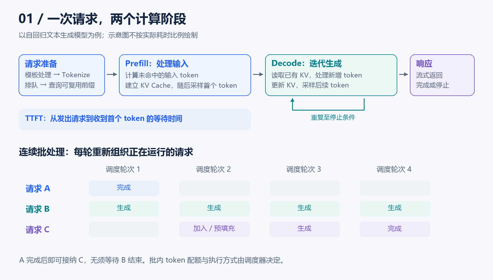
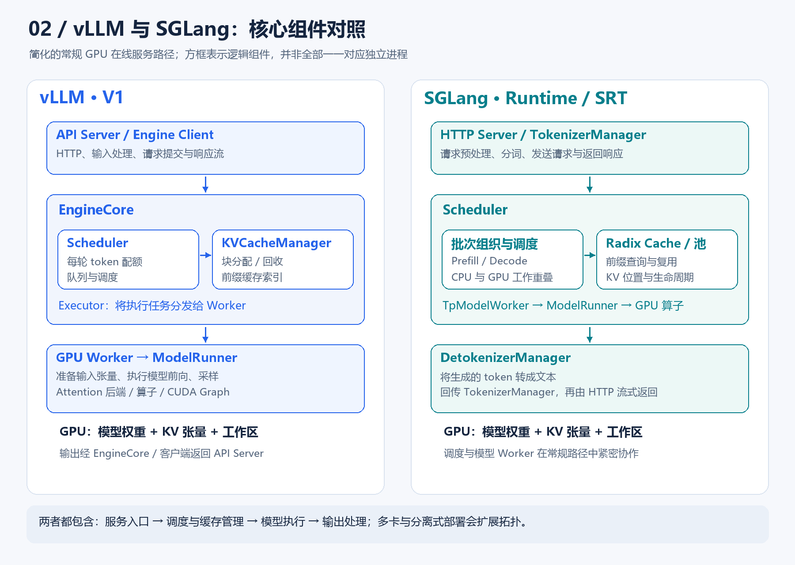
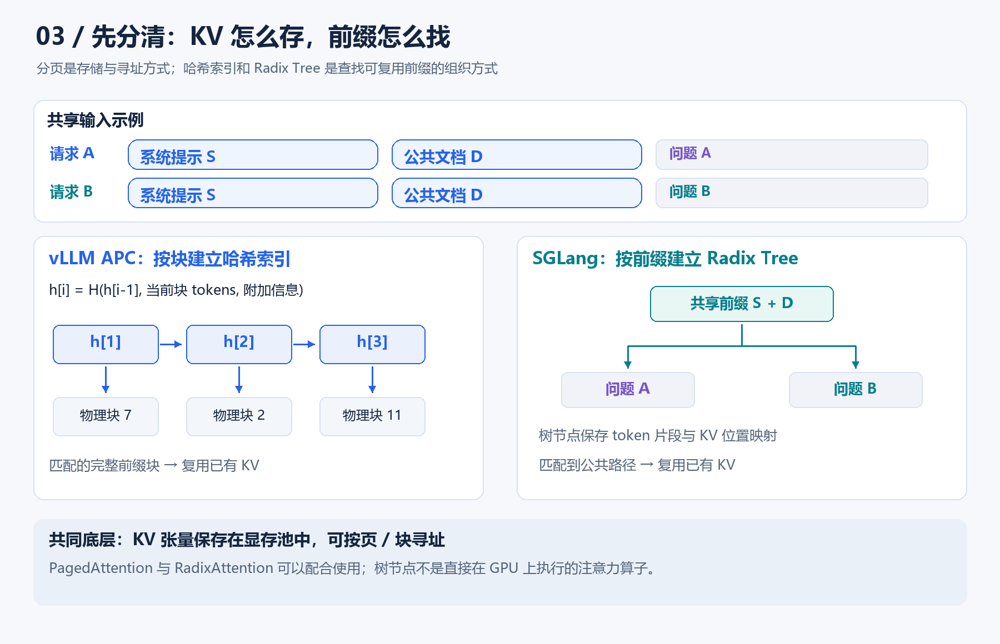

# 从 KV Cache 到调度器：读懂 vLLM 与 SGLang 的架构与差异

> 本文聚焦自回归大语言模型的推理与在线服务；vLLM 以 V1 架构为主，SGLang 以 SGLang Runtime（SRT）为主。配图为根据官方资料绘制的教学示意图，不代表性能测试结果。

把一个大模型加载到 GPU 上，只解决了“能运行”的问题。当几十、几百个用户同时提交请求时，系统还必须决定：哪些请求一起计算？显存如何分配？哪些历史计算可以复用？怎样让用户尽快看到首字，并保持流畅输出？

**vLLM 和 SGLang，就是围绕这些问题构建的推理与服务框架。**

理解两者，可以从各自的技术起点入手：vLLM 因 PagedAttention 和高效 KV 显存管理而广为人知；SGLang 从结构化语言模型程序出发，强调前端表达能力与后端运行时的协同，并提出 RadixAttention 来复用 KV Cache。今天，两者的能力已经有大量重叠，不能用早期的一两个标签划定边界。[vLLM 原始论文](https://arxiv.org/abs/2309.06180)、[SGLang 原始论文](https://arxiv.org/abs/2312.07104)

## 一、先理解推理框架到底在优化什么

### 1. Prefill 与 Decode：同一次生成里的两种工作

假设用户输入“请解释一下什么是 KV Cache”，模型的生成通常经历两个阶段。

**Prefill，预填充阶段**：处理输入的 token，计算相应的中间状态，建立 KV Cache，并利用最后位置的输出分布采样第一个生成 token。

**Decode，解码阶段**：在普通自回归路径中，每轮处理新增 token，读取之前保存的 KV，更新缓存，再采样下一个 token，直到满足停止条件。

较长输入的 Prefill 往往更容易体现算力瓶颈；小批量 Decode 往往更容易受显存带宽和调度开销影响。它们是常见趋势，具体瓶颈还取决于批大小、上下文长度、模型结构与硬件。



为了避免长输入让正在生成的请求长时间等待，框架可以把 Prefill 拆成多个小块，与 Decode 工作协调执行，这就是 **Chunked Prefill**。vLLM V1 的相关策略用每轮 token 预算控制工作量；块大小会影响首字等待、后续输出间隔和吞吐之间的权衡。[vLLM 调优文档](https://docs.vllm.ai/en/latest/configuration/optimization/)

### 2. KV Cache：用显存换取重复计算的减少

Transformer 的注意力计算包含 Query、Key、Value。自回归生成时，历史 token 的 Key 和 Value 可以保存下来，供后续步骤读取。

**KV Cache 缓存的是模型中间状态，不是上一道题的最终答案。** 它避免反复计算历史 token 的 K/V，但新 token 仍然需要读取历史 KV 并完成注意力计算。

对于常规全注意力 MHA/GQA 模型，忽略分片、共享和额外开销，单条序列的 KV 存储量可近似写成：

\[
M_{KV} \approx 2 \times L \times T \times H_{KV} \times D_{head} \times B
\]

其中，2 代表 K 和 V，\(L\) 是层数，\(T\) 是已缓存 token 数，\(H_{KV}\) 是 KV 头数，\(D_{head}\) 是头维度，\(B\) 是每个元素的字节数。

做一个量级估算：32 层、8 个 KV 头、头维度 128、8192 个 token、每元素 2 字节，一条序列的 KV 就约为 **1 GiB**。这还没有算模型权重和其他工作区；MLA、滑动窗口和混合架构需要按实际缓存结构另算。

因此，“模型权重能放进显存”并不意味着“还能支持很多长上下文请求”。

### 3. Continuous Batching：每轮都可以调整批次

静态批处理通常先凑齐一批请求，再等待这一批结束。问题是，不同请求的输出长度差别很大：短请求已经结束，长请求仍在继续。

**连续批处理允许在迭代边界移除已完成请求、加入新请求。** GPU 可以持续处理多个请求的工作，减少等待和空闲。这是两者共同采用的重要机制；它不等于“把多个用户的文本拼成一个 prompt”。[vLLM 项目说明](https://github.com/vllm-project/vllm)、[SGLang 项目说明](https://github.com/sgl-project/sglang)

## 二、vLLM：从分页 KV 管理到完整推理引擎

### 1. PagedAttention 解决什么问题？

如果每条请求都预留一整块最大长度的连续 KV 空间，会浪费显存；随着请求增长、结束和交错执行，也容易产生碎片。

PagedAttention 借鉴了虚拟内存的分页思想：把 KV 划分为固定大小的块，通过映射找到对应的物理块。**逻辑上连续的 token，其 KV 不必占用一整段连续物理空间。**

例如，假设一块容纳 4 个 token，一个包含 10 个 token 的请求可以使用 3 块、共 12 个 token 的容量，而不必从一开始就按最大长度预留空间。这里的数字仅用于解释机制。

它的价值在于降低碎片和过度预留，让同一张 GPU 容纳更多有效请求；它并没有缩小每个 KV 元素本身，也没有消除所有内存开销。实际实现常会先建立显存池，再按需把池中的块分配给请求。[PagedAttention 论文](https://arxiv.org/abs/2309.06180)

### 2. vLLM V1 由哪些组件组成？



沿着一次请求看，vLLM V1 的核心职责可以这样划分：

| 组件 | 主要职责 |
|---|---|
| API Server / Engine Client | 接收请求、处理输入，将请求交给引擎并返回结果流 |
| EngineCore | 驱动执行循环，协调调度、缓存与模型执行 |
| Scheduler | 决定哪些请求参与本轮、分别计算多少 token |
| KVCacheManager | 管理 KV 块、前缀命中、引用和回收 |
| Executor / Worker | 分发执行任务，管理相应设备上的模型执行 |
| ModelRunner / 算子后端 | 准备张量，运行前向、注意力计算和采样等步骤 |

这些是逻辑职责，不应把每一行都理解成一个独立进程。V1 的一个关键设计是把 API 处理、引擎核心和 GPU Worker 的工作分离，使输入处理、流式输出与模型执行能够更好地重叠。[vLLM 架构文档](https://docs.vllm.ai/en/latest/design/arch_overview/)

另一个值得学习的点是，V1 调度器用统一的“本轮各请求计算多少 token”来表达调度，例如：

```text
请求 A：处理 1 个 token
请求 B：处理 1 个 token
请求 C：处理 256 个 token
```

A、B 可以是正在 Decode 的请求，C 可以是在处理一段 Prefill。这里的统一是调度表示的统一，Prefill 与 Decode 的计算特征仍然不同。[vLLM V1 设计介绍](https://vllm.ai/blog/2025-01-27-v1-alpha-release)

### 3. vLLM 也会自动复用前缀

vLLM 的 Automatic Prefix Caching，简称 APC，会查找新请求中已经计算过的前缀 KV。

其典型组织方式是给完整 KV 块建立哈希标识，哈希信息包括前一块的哈希、当前块 token，以及必要的附加标识，例如 LoRA 或多模态输入信息。把“前面的内容”纳入标识，是因为同一段 token 放在不同上下文后面，其 KV 通常并不相同。[vLLM APC 设计](https://docs.vllm.ai/en/latest/design/prefix_caching/)

因此，**“vLLM 只管分页、不支持跨请求前缀复用”是错误理解。**

从工程使用看，vLLM 同时提供离线推理和在线服务接口，并覆盖多种模型、硬件、量化方案和并行方式。其价值应作为一整套服务系统来理解，不能只看作一个注意力算法。[vLLM 项目说明](https://github.com/vllm-project/vllm)

## 三、SGLang：从结构化程序到缓存感知运行时

### 1. 区分 Frontend Language 与 Runtime

SGLang 的名字来源于 Structured Generation Language。理解其组成时，需要区分两个层面。

**Frontend Language 是编程接口。** 它可以表达多次生成、选择、分支及状态操作；这里的“前端”指语言接口，不是网页前端。

**Runtime，也就是 SRT，是推理执行系统。** 它负责调度、缓存、模型执行和服务响应。业务可以通过 HTTP API 直接调用 SRT，并不要求使用 SGLang DSL。[SGLang 前端语言文档](https://docs.sglang.io/docs/references/frontend/frontend_tutorial)、[SGLang 快速开始](https://docs.sglang.io/docs/get-started/quickstart)

### 2. RadixAttention 解决什么问题？

设想有两条请求：

```text
A：系统提示 + 公共文档 + 问题 A
B：系统提示 + 公共文档 + 问题 B
```

如果公共部分的 KV 仍在缓存中，就有机会直接复用。

RadixAttention 使用 **Radix Tree，压缩前缀树**，组织 token 序列与其 KV 位置的对应关系。共享前缀沿同一条路径保存，后续差异形成分支。新请求到来时，运行时查找可用的匹配前缀，仅继续处理未命中的部分；缓存不足时，再结合引用状态和淘汰策略释放空间。[SGLang RadixAttention 介绍](https://www.lmsys.org/blog/2024-01-17-sglang/)



这里要分清三个层次：

| 技术 | 主要回答的问题 |
|---|---|
| PagedAttention / 分页 KV 管理 | KV 如何分块存储、分配和寻址？ |
| APC / RadixAttention | 如何找到并复用已计算过的前缀 KV？ |
| FlashAttention 等注意力后端 | 实际的注意力计算怎样高效执行？ |

**PagedAttention 与 RadixAttention 可以配合使用。** 树结构主要组织缓存元数据，真正的 KV 张量仍在显存等存储层中；不能把 RadixAttention 理解成一种替代 Transformer 注意力公式的数学机制。SGLang 的具体注意力后端也会根据模型和硬件选择。[RadixAttention 原始介绍](https://www.lmsys.org/blog/2024-01-17-sglang/)、[SGLang 注意力后端文档](https://docs.sglang.io/docs/advanced_features/attention_backend)

### 3. SGLang 的运行时组件

常规 HTTP 服务路径中，请求主要经过以下组件：

| 组件 | 主要职责 |
|---|---|
| HTTP Server / TokenizerManager | 接收请求、预处理和分词，发送给调度器，收集结果 |
| Scheduler | 维护请求队列，进行前缀匹配并组织执行批次 |
| Radix Cache / 内存池 | 管理可复用前缀、请求到 KV 位置的映射及资源生命周期 |
| TpModelWorker / ModelRunner | 执行模型前向、并行通信和相应 GPU 计算 |
| DetokenizerManager | 把输出 token 转成文本，回传给 TokenizerManager |

在常规实现中，HTTP Server、Engine 和 TokenizerManager 位于主进程，Scheduler 与 DetokenizerManager 使用子进程，组件通过消息通信协作；更多 tokenizer worker、并行和网关部署会扩展这一拓扑。[SGLang Engine 源码](https://github.com/sgl-project/sglang/blob/main/python/sglang/srt/entrypoints/engine.py)、[Scheduler 源码](https://github.com/sgl-project/sglang/blob/main/python/sglang/srt/managers/scheduler.py)

### 4. SGLang 还有哪些有代表性的设计？

**重叠调度。** GPU 计算当前批次时，CPU 提前准备下一批需要的调度和元数据，尽量隐藏 CPU 开销。官方所说的“zero-overhead scheduler”描述的是减少关键路径上的可见开销，不意味着 CPU 完全不工作，也不保证所有负载都没有等待。[SGLang 重叠调度介绍](https://www.lmsys.org/blog/2024-12-04-sglang-v0-4/)

**结构化输出。** 通过 JSON Schema、正则表达式或语法约束限制生成过程，适合信息抽取和工具参数生成。但格式正确仍不等于内容事实正确；vLLM 也具备结构化输出能力。[SGLang 结构化输出](https://docs.sglang.io/docs/advanced_features/structured_outputs)、[vLLM 结构化输出](https://docs.vllm.ai/en/latest/features/structured_outputs/)

**HiCache 分层缓存。** 将 KV 缓存扩展到 GPU 显存、主机内存和存储后端。它扩大了可保留的缓存规模，但低层缓存命中还需要数据传输；跨实例共享也取决于是否配置了相应的共享存储后端。[SGLang HiCache 设计](https://docs.sglang.io/docs/advanced_features/hicache_design)

**缓存感知路由。** 多实例部署时，网关可以同时考虑缓存命中机会与实例负载，使请求有机会到达保存着相关前缀的实例。仅在单个实例内部维护缓存，并不能保证多实例部署自然获得高命中率。[SGLang Model Gateway](https://docs.sglang.io/docs/advanced_features/sgl_model_gateway)

## 四、两者有哪些共同点，又有哪些差异？

从目前公开的功能看，两者都支持连续批处理、前缀缓存、分块预填充、结构化输出、量化、推测解码以及多 GPU 推理。具体功能能否组合使用，取决于版本、模型、设备和算子后端。[vLLM 功能说明](https://github.com/vllm-project/vllm)、[SGLang 功能说明](https://github.com/sgl-project/sglang)

更有价值的比较，是看核心抽象与工程组织方式：

| 维度 | vLLM | SGLang |
|---|---|---|
| 技术起点 | PagedAttention、高效 KV 内存管理与服务吞吐 | 结构化模型程序、前端与运行时协同、RadixAttention |
| 典型前缀索引 | 完整 KV 块的哈希索引 | Radix Tree 及其扩展缓存结构 |
| 核心运行时组织 | EngineCore 协调 Scheduler、缓存管理和 Executor | TokenizerManager、Scheduler、模型 Worker 与 DetokenizerManager 协作 |
| 编程入口 | 离线 Python 接口、在线 API | Runtime/API，加上可选的前端语言 |
| CPU 开销优化 | 进程分离、轻量调度及执行路径优化 | 重叠调度、流水化请求处理 |
| 结构化输出 | 支持，具有相应语法后端 | 支持，具有相应语法后端 |
| 分离式推理 | 提供 Prefill/Decode 分离及 KV 传输接口 | 提供 PD 分离，并与路由、缓存系统协同 |
| 性能判断 | 需要针对具体模型与负载测试 | 需要针对具体模型与负载测试 |

表中的设计起点是帮助理解的历史线索，不是今天的功能边界。两者都已有 Prefill/Decode 分离方案：把两类计算部署到不同资源上，并在它们之间传递 KV。该方案有独立扩缩容和减少相互干扰的潜力，同时引入传输与部署成本。[vLLM 分离式 Prefill](https://docs.vllm.ai/en/latest/features/disagg_prefill/)、[SGLang PD 分离](https://docs.sglang.io/docs/advanced_features/pd_disaggregation)

也不能仅凭“树”和“哈希表”判断速度。端到端性能还受到缓存粒度、命中率、CPU 调度、算子实现、模型结构和通信拓扑的共同影响。

## 五、用一个业务例子理解缓存收益

假设一个文档问答系统有如下输入：

```text
固定系统提示：  500 tokens
公共长文档：   8000 tokens
每次的新问题：  100 tokens
```

如果后续请求具有完全相同的前 8500 个 token，且相关缓存仍然有效、可访问，那么 vLLM APC 和 SGLang RadixAttention 都有机会复用这段前缀的大部分 KV。剩余工作包括未命中后缀、可能的块边界部分及生成答案的计算。

这里需要注意三件事。

**第一，匹配的是 token 前缀，而不是语义相似度。** 模板、空格、消息顺序和动态字段都可能改变实际 token 序列；模型、适配器等影响 KV 的条件也必须兼容。

**第二，前缀缓存主要减少重复 Prefill。** 它不会替你生成新的答案，也不会让 Decode 读取历史 KV 的工作消失。输入很长、输出较短时收益可能明显；输出占据大部分耗时时，端到端加速就可能有限。[vLLM APC 的适用范围](https://docs.vllm.ai/en/latest/features/automatic_prefix_caching/)

**第三，多轮对话和 RAG 都不天然等于高命中率。** 多轮聊天只有保留一致的历史前缀才便于复用；RAG 如果每次检索结果、顺序和模板都不同，可能只命中较短的公共部分。

由此可以得到一个应用设计建议：在语义允许的情况下，把稳定、可共享的内容放在输入前部，把变化内容放在后部。收益仍需通过真实命中率和时延验证。

## 六、应该怎样选型与测试？

以下是基于机制的工程建议，不是性能排名。

如果你要建立通用模型 API 服务，可以把 vLLM 作为一个容易组织评测的候选，同时测试 SGLang。若你的负载有大量共享长前缀、多轮状态或分支生成，则尤其值得测试 SGLang 的缓存与路由组合，并与开启 APC 的 vLLM 公平比较。

如果使用大型 MoE、多节点或特殊硬件，应优先核对具体模型、量化格式、注意力后端、并行方式和通信链路的支持情况。框架名本身不能回答这些兼容性问题。

评测时至少记录以下指标：

| 指标 | 反映什么 |
|---|---|
| TTFT | 从请求发出到首个 token 到达，用户先等多久 |
| TPOT / ITL | 后续 token 的平均生成耗时 / 相邻输出间隔 |
| 输出吞吐 | 服务整体每秒生成多少输出 token |
| P95/P99 延迟 | 较慢请求和尾部体验是否可接受 |
| 缓存命中率与排队时间 | 加速是否来自复用，以及系统是否过载 |
| 满足时延目标的有效吞吐 | 在用户可接受的响应速度下，系统实际能承载多少业务 |

客户端与服务端计时边界可能不同；流式响应一次也可能包含多个 token，因此 ITL 与 TPOT 不能不加区分地混用。[vLLM 指标定义](https://docs.vllm.ai/en/latest/design/metrics/)

一个有解释力的对照实验，应固定模型与权重版本、硬件、精度、输入输出分布、采样参数和请求到达方式，并分别测试：

1. **冷缓存与热缓存**：分开观察首次计算和前缀复用的效果。
2. **短输入长输出与长输入短输出**：区分 Decode 与 Prefill 占比。
3. **无共享前缀与高共享前缀**：检查缓存机制是否与业务匹配。
4. **不同并发或到达速率**：同时看吞吐和尾延迟。

模型加载、算子编译和预热应与稳定服务阶段分开统计。不要把某个旧版本、特定 GPU 上的单次倍率，直接写成框架的普遍优劣。

## 七、最小实践：用同一种请求调用两套服务

下面的命令用于理解入口，假设已在适配的 Linux/GPU 环境中分别安装好两套框架。它们依据官方文档整理，本文不包含本机 GPU 实测结果。

启动 vLLM：

```bash
vllm serve Qwen/Qwen2.5-1.5B-Instruct --host 127.0.0.1 --port 8000
```

启动 SGLang：

```bash
sglang serve Qwen/Qwen2.5-1.5B-Instruct --host 127.0.0.1 --port 30000
```

当前 SGLang 快速开始使用 `sglang serve`，已有资料中也常见 `python -m sglang.launch_server --model-path ...`；应与安装版本的文档对应。[vLLM 快速开始](https://docs.vllm.ai/en/latest/getting_started/quickstart/)、[SGLang 快速开始](https://docs.sglang.io/docs/get-started/quickstart)

以 vLLM 为例，发送一次请求：

```bash
curl http://127.0.0.1:8000/v1/chat/completions \
  -H "Content-Type: application/json" \
  -d '{
    "model": "Qwen/Qwen2.5-1.5B-Instruct",
    "messages": [{"role": "user", "content": "用三句话解释 KV Cache。"}],
    "max_tokens": 128,
    "temperature": 0,
    "stream": false
  }'
```

换成 `30000` 端口即可向上述 SGLang 服务发送同样的基础请求。接口兼容让应用比较容易切换后端，但高级参数、工具调用解析、结构化输出细节和具体功能组合仍需要分别验证。

学习源码时，可以顺着“请求进入 → 调度与缓存查询 → 模型执行 → 结果返回”跟踪一次调用：先理解每个组件如何协作，再进入注意力算子和分布式优化。这条路径也更容易解释一个服务为什么首字慢、为什么吞吐低，以及调整哪里才可能有效。
